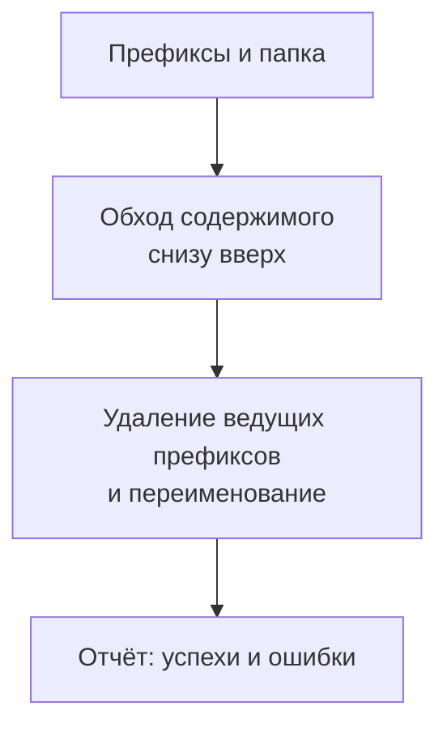

# Скрипты для удаления префиксов из названий файлов и папок

[](https://github.com/yaleksandr89/remove-prefix)
[](docs/langs/ru/guides/usage.md)
[](docs/langs/ru/guides/usage.md)
[](https://github.com/yaleksandr89/remove-prefix/actions/workflows/ci.yml)
[](LICENSE.md)


**Русский** | [English](docs/langs/en/README.md) | [Español](docs/langs/es/README.md) | [中文](docs/langs/zh/README.md) | [Français](docs/langs/fr/README.md) | [Deutsch](docs/langs/de/README.md)

## Описание

Remove Prefix рекурсивно удаляет указанные ведущие префиксы из имён файлов и папок в выбранной директории. Утилита помогает очистить имена после скачивания, упростить структуру проектов и автоматизировать рутинное переименование.

- Несколько префиксов за один запуск; повторяющиеся ведущие префиксы удаляются последовательно.
- Bash для Linux и macOS, PowerShell для Windows.
- Отчёт о времени выполнения, памяти и количестве переименованных файлов и папок.

## Как работает утилита



## Быстрый старт

Требования: Git для клонирования; Windows 10/11 с PowerShell 5.1 или выше либо Linux/macOS с Bash 4.0+ и утилитами `find`, `mv`, `ps`, `awk`, `date`, `bc`. На macOS используйте Bash 4.0+ из `PATH`, а не штатный `/bin/bash` 3.2.

**Скрипты изменяют имена на диске. Сначала сделайте резервную копию и проверьте работу на отдельной копии данных. Не запускайте их от администратора или root без необходимости.**

### Windows (PowerShell)

```powershell
git clone https://github.com/yaleksandr89/remove-prefix.git
cd remove-prefix
.\scripts\remove_prefix.ps1
```

### Linux/macOS (Bash)

```bash
git clone https://github.com/yaleksandr89/remove-prefix.git
cd remove-prefix
bash scripts/remove_prefix.sh
```

Введите префиксы через запятую, затем путь к папке. Например, `ad_,pre_` и путь к тестовой директории. Корневая папка не переименовывается.

## Документация

- [Использование и примеры](docs/langs/ru/guides/usage.md)
- [Участие в разработке](.github/CONTRIBUTING.md)
- [Безопасность](.github/SECURITY.md)

## Обратная связь

- [Сообщить об ошибке или предложить улучшение](https://github.com/yaleksandr89/remove-prefix/issues)
- [Обсуждения и вопросы](https://github.com/yaleksandr89/remove-prefix/discussions)
- [Сообщить об уязвимости](.github/SECURITY.md)

<p align="center">Если проект оказался полезен, поставьте звезду на GitHub — так его будет проще найти другим разработчикам. 🤘</p>
