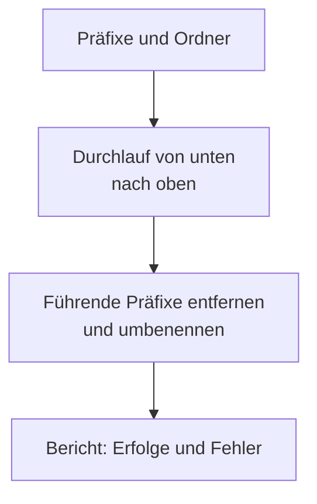

# Skripte zum Entfernen von Präfixen aus Datei- und Ordnernamen

[](https://github.com/yaleksandr89/remove-prefix)
[](guides/usage.md)
[](guides/usage.md)
[](https://github.com/yaleksandr89/remove-prefix/actions/workflows/ci.yml)
[](../../../LICENSE.md)


[Русский](../../../README.md) | [English](../en/README.md) | [Español](../es/README.md) | [中文](../zh/README.md) | [Français](../fr/README.md) | **Deutsch**

## Übersicht

Remove Prefix entfernt rekursiv angegebene führende Präfixe aus Datei- und Ordnernamen in einem ausgewählten Verzeichnis. Damit lassen sich heruntergeladene Dateinamen bereinigen, Projektstrukturen vereinfachen und wiederkehrende Umbenennungen automatisieren.

- Mehrere Präfixe pro Durchlauf; wiederholte führende Präfixe werden nacheinander entfernt.
- Bash für Linux und macOS, PowerShell für Windows.
- Bericht über Laufzeit, Speichernutzung und Anzahl umbenannter Dateien und Ordner.

## Funktionsweise



## Schnellstart

Voraussetzungen: Git zum Klonen; Windows 10/11 mit PowerShell 5.1 oder höher oder Linux/macOS mit Bash 4.0+ sowie `find`, `mv`, `ps`, `awk`, `date`, `bc`. Verwenden Sie unter macOS Bash 4.0+ aus `PATH`, nicht das integrierte `/bin/bash` 3.2.

**Die Skripte ändern Namen auf dem Datenträger. Sichern Sie Ihre Daten und testen Sie zuerst an einer separaten Kopie. Führen Sie die Skripte nur bei Bedarf als Administrator oder root aus.**

### Windows (PowerShell)

```powershell
git clone https://github.com/yaleksandr89/remove-prefix.git
cd remove-prefix
.\scripts\remove_prefix.ps1
```

### Linux/macOS (Bash)

```bash
git clone https://github.com/yaleksandr89/remove-prefix.git
cd remove-prefix
bash scripts/remove_prefix.sh
```

Geben Sie kommagetrennte Präfixe und anschließend den Ordnerpfad ein, beispielsweise `ad_,pre_` und den Pfad zu einem Testverzeichnis. Der Stammordner selbst wird nicht umbenannt.

## Dokumentation

- [Verwendung und Beispiele](guides/usage.md)
- [Mitwirken](CONTRIBUTING.md)
- [Sicherheit](SECURITY.md)

## Rückmeldungen

- [Fehler melden oder Verbesserung vorschlagen](https://github.com/yaleksandr89/remove-prefix/issues)
- [Diskussionen und Fragen](https://github.com/yaleksandr89/remove-prefix/discussions)
- [Schwachstelle melden](SECURITY.md)

<p align="center">Wenn dieses Projekt hilfreich war, geben Sie ihm einen Stern auf GitHub, damit andere Entwickler es leichter finden können. 🤘</p>
