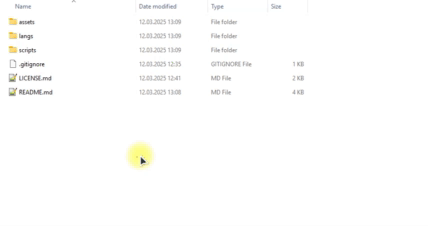
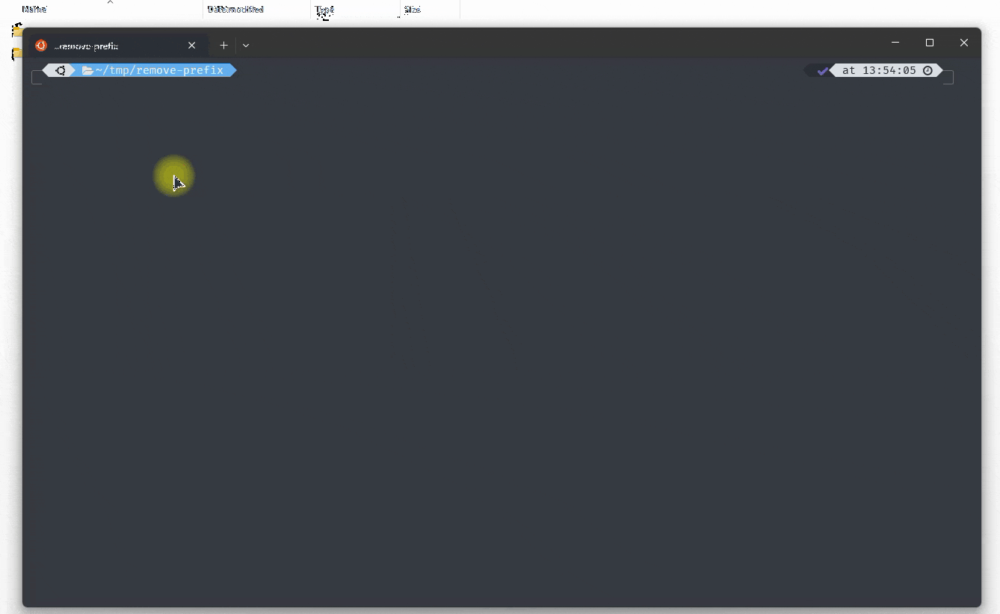

# Verwendung und Beispiele

[Skripte zum Entfernen von Präfixen aus Datei- und Ordnernamen](../README.md)

Voraussetzungen: Git zum Klonen; Windows 10/11 mit PowerShell 5.1 oder höher oder Linux/macOS mit Bash 4.0+ sowie `find`, `mv`, `ps`, `awk`, `date`, `bc`. Verwenden Sie unter macOS Bash 4.0+ aus `PATH`, nicht das integrierte `/bin/bash` 3.2.

**Die Skripte ändern Namen auf dem Datenträger. Sichern Sie Ihre Daten und testen Sie zuerst an einer separaten Kopie. Führen Sie die Skripte nur bei Bedarf als Administrator oder root aus.**

## Windows (PowerShell)

```powershell
git clone https://github.com/yaleksandr89/remove-prefix.git
cd remove-prefix
.\scripts\remove_prefix.ps1
```

Wenn die Ausführungsrichtlinie ein geprüftes lokales Skript blockiert, verwenden Sie für die aktuelle Sitzung `Set-ExecutionPolicy -Scope Process -ExecutionPolicy RemoteSigned`, sofern Ihre Organisation dies erlaubt. Öffnen Sie kein Administrator-Terminal und setzen Sie die Benutzerrichtlinie nicht auf Unrestricted.

Geben Sie kommagetrennte Präfixe und anschließend den Ordnerpfad ein, beispielsweise `ad_,pre_` und den Pfad zu einem Testverzeichnis. Der Stammordner selbst wird nicht umbenannt.




## Linux/macOS (Bash)

```bash
git clone https://github.com/yaleksandr89/remove-prefix.git
cd remove-prefix
bash scripts/remove_prefix.sh
```

Geben Sie kommagetrennte Präfixe und anschließend den Ordnerpfad ein, beispielsweise `ad_,pre_` und den Pfad zu einem Testverzeichnis. Der Stammordner selbst wird nicht umbenannt.



## Verarbeitungsreihenfolge

Präfixe werden in Eingabereihenfolge, unter Beachtung der Groß-/Kleinschreibung und nur am Namensanfang angewendet. Jedes Präfix wird wiederholt entfernt, solange es passt. Mit `ad_,pre_` wird `ad_ad_pre_photo.jpg` zu `photo.jpg`, während `my_ad_photo.jpg` unverändert bleibt. Verschachtelte Elemente werden vor ihren übergeordneten Ordnern verarbeitet. Verwenden Sie keine aktiven, gemeinsam genutzten oder Systemverzeichnisse; arbeiten Sie an einem stabilen Verzeichnisbaum ohne gleichzeitige Umbenennungen. Verlassen Sie sich nicht auf automatisches Rückgängigmachen oder die Verarbeitung versteckter Windows-Elemente (PowerShell listet diese standardmäßig nicht auf).

## Bericht

Der Bericht zeigt Laufzeit, Änderung der Speichernutzung sowie die Anzahl erfolgreich umbenannter Dateien und Ordner. Prüfen Sie Fehler und Konflikte; der Bericht ersetzt keine Ergebniskontrolle. Die Abbildungen zeigen frühere Beispielausgaben, keine garantierten Werte.


## Projektstruktur

`scripts/` enthält beide Werkzeuge, `tests/` die Regressionstests, `docs/assets/` das Titelbild und die Demonstrationen, `docs/langs/` die Übersetzungen.
