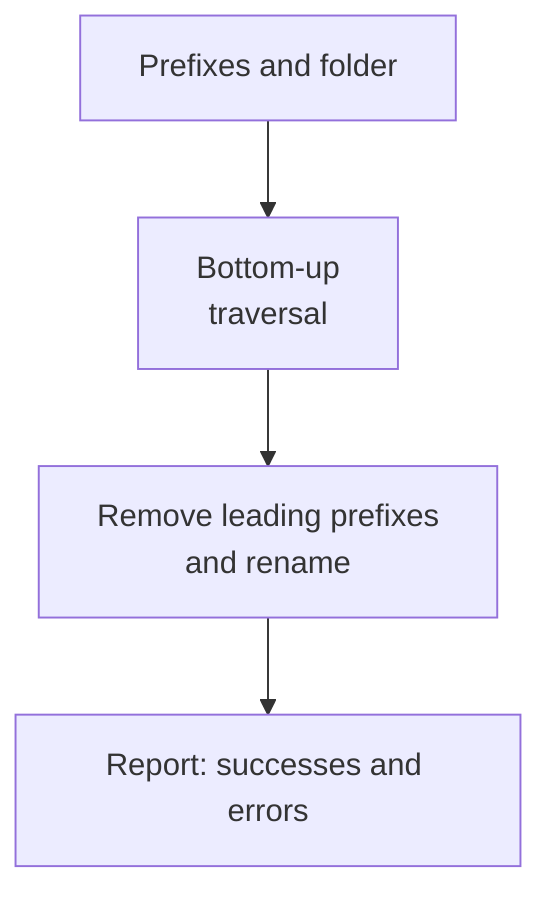

# Scripts for removing prefixes from file and folder names

[](https://github.com/yaleksandr89/remove-prefix)
[](guides/usage.md)
[](guides/usage.md)
[](https://github.com/yaleksandr89/remove-prefix/actions/workflows/ci.yml)
[](../../../LICENSE.md)


[Русский](../../../README.md) | **English** | [Español](../es/README.md) | [中文](../zh/README.md) | [Français](../fr/README.md) | [Deutsch](../de/README.md)

## Overview

Remove Prefix recursively removes specified leading prefixes from file and folder names in a selected directory. It helps clean up downloaded filenames, simplify project structures and automate repetitive renaming.

- Multiple prefixes per run; repeated leading prefixes are removed in sequence.
- Bash for Linux and macOS, PowerShell for Windows.
- Report with execution time, memory usage and counts of renamed files and folders.

## How it works



## Quick start

Requirements: Git to clone; Windows 10/11 with PowerShell 5.1 or later, or Linux/macOS with Bash 4.0+ and `find`, `mv`, `ps`, `awk`, `date`, `bc`. On macOS use Bash 4.0+ from `PATH`, not the built-in `/bin/bash` 3.2.

**The scripts change names on disk. Back up your data and test on a separate copy first. Do not run as administrator or root unless necessary.**

### Windows (PowerShell)

```powershell
git clone https://github.com/yaleksandr89/remove-prefix.git
cd remove-prefix
.\scripts\remove_prefix.ps1
```

### Linux/macOS (Bash)

```bash
git clone https://github.com/yaleksandr89/remove-prefix.git
cd remove-prefix
bash scripts/remove_prefix.sh
```

Enter comma-separated prefixes, then the folder path. For example, `ad_,pre_` and the path to a test directory. The root folder itself is not renamed.

## Documentation

- [Usage and examples](guides/usage.md)
- [Contributing](CONTRIBUTING.md)
- [Security](SECURITY.md)

## Feedback

- [Report a bug or suggest an improvement](https://github.com/yaleksandr89/remove-prefix/issues)
- [Discussions and questions](https://github.com/yaleksandr89/remove-prefix/discussions)
- [Report a vulnerability](SECURITY.md)

<p align="center">If this project was useful, give it a star on GitHub to help other developers find it. 🤘</p>
