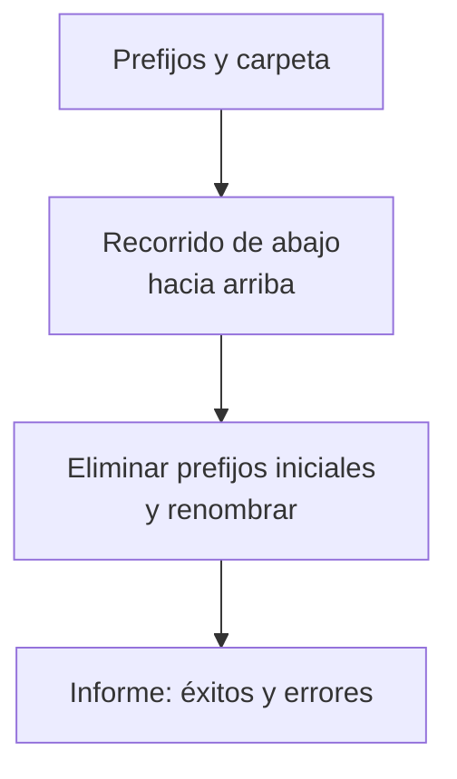

# Scripts para eliminar prefijos de nombres de archivos y carpetas

[](https://github.com/yaleksandr89/remove-prefix)
[](guides/usage.md)
[](guides/usage.md)
[](https://github.com/yaleksandr89/remove-prefix/actions/workflows/ci.yml)
[](../../../LICENSE.md)


[Русский](../../../README.md) | [English](../en/README.md) | **Español** | [中文](../zh/README.md) | [Français](../fr/README.md) | [Deutsch](../de/README.md)

## Descripción

Remove Prefix elimina recursivamente los prefijos iniciales indicados de los nombres de archivos y carpetas de un directorio seleccionado. Sirve para limpiar nombres de archivos descargados, simplificar estructuras de proyectos y automatizar cambios de nombre repetitivos.

- Varios prefijos por ejecución; los prefijos iniciales repetidos se eliminan en secuencia.
- Bash para Linux y macOS, PowerShell para Windows.
- Informe con tiempo de ejecución, uso de memoria y cantidad de archivos y carpetas renombrados.

## Cómo funciona



## Inicio rápido

Requisitos: Git para clonar; Windows 10/11 con PowerShell 5.1 o posterior, o Linux/macOS con Bash 4.0+ y `find`, `mv`, `ps`, `awk`, `date`, `bc`. En macOS utilice Bash 4.0+ desde `PATH`, no el `/bin/bash` 3.2 integrado.

**Los scripts cambian nombres en el disco. Haga una copia de seguridad y pruebe primero en una copia separada. No los ejecute como administrador o root salvo que sea necesario.**

### Windows (PowerShell)

```powershell
git clone https://github.com/yaleksandr89/remove-prefix.git
cd remove-prefix
.\scripts\remove_prefix.ps1
```

### Linux/macOS (Bash)

```bash
git clone https://github.com/yaleksandr89/remove-prefix.git
cd remove-prefix
bash scripts/remove_prefix.sh
```

Introduzca los prefijos separados por comas y después la ruta de la carpeta. Por ejemplo, `ad_,pre_` y la ruta de un directorio de prueba. La carpeta raíz no se renombra.

## Documentación

- [Uso y ejemplos](guides/usage.md)
- [Contribuir](CONTRIBUTING.md)
- [Seguridad](SECURITY.md)

## Comentarios y ayuda

- [Informar de un error o proponer una mejora](https://github.com/yaleksandr89/remove-prefix/issues)
- [Debates y preguntas](https://github.com/yaleksandr89/remove-prefix/discussions)
- [Informar de una vulnerabilidad](SECURITY.md)

<p align="center">Si el proyecto le resultó útil, dele una estrella en GitHub para que otros desarrolladores puedan encontrarlo. 🤘</p>
