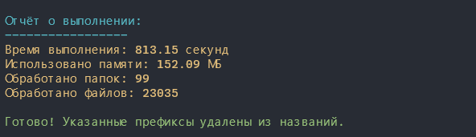

# Uso y ejemplos

[Scripts para eliminar prefijos de nombres de archivos y carpetas](../README.md)

Requisitos: Git para clonar; Windows 10/11 con PowerShell 5.1 o posterior, o Linux/macOS con Bash 4.0+ y `find`, `mv`, `ps`, `awk`, `date`, `bc`. En macOS utilice Bash 4.0+ desde `PATH`, no el `/bin/bash` 3.2 integrado.

**Los scripts cambian nombres en el disco. Haga una copia de seguridad y pruebe primero en una copia separada. No los ejecute como administrador o root salvo que sea necesario.**

## Windows (PowerShell)

```powershell
git clone https://github.com/yaleksandr89/remove-prefix.git
cd remove-prefix
.\scripts\remove_prefix.ps1
```

Si la política de ejecución bloquea un script local revisado, utilice `Set-ExecutionPolicy -Scope Process -ExecutionPolicy RemoteSigned` para la sesión actual si la organización lo permite. No abra una terminal de administrador ni establezca la política del usuario en Unrestricted.

Introduzca los prefijos separados por comas y después la ruta de la carpeta. Por ejemplo, `ad_,pre_` y la ruta de un directorio de prueba. La carpeta raíz no se renombra.


## Linux/macOS (Bash)

```bash
git clone https://github.com/yaleksandr89/remove-prefix.git
cd remove-prefix
bash scripts/remove_prefix.sh
```

Introduzca los prefijos separados por comas y después la ruta de la carpeta. Por ejemplo, `ad_,pre_` y la ruta de un directorio de prueba. La carpeta raíz no se renombra.


## Orden de procesamiento

Los prefijos se aplican en el orden de entrada, distinguiendo mayúsculas y minúsculas, solo al inicio del nombre. Cada prefijo se elimina repetidamente mientras coincida. Con `ad_,pre_`, `ad_ad_pre_photo.jpg` pasa a `photo.jpg`, mientras que `my_ad_photo.jpg` no cambia. Los elementos anidados se procesan antes que las carpetas superiores. No utilice directorios activos, compartidos o del sistema; trabaje con un árbol estable sin cambios de nombre concurrentes. No cuente con una reversión automática ni con el procesamiento de elementos ocultos de Windows (PowerShell no los enumera por defecto).

## Informe

El informe muestra el tiempo transcurrido, el cambio de uso de memoria y la cantidad de archivos y carpetas renombrados correctamente. Revise los errores y conflictos; el informe no sustituye la comprobación del resultado. Las imágenes muestran ejemplos de salidas anteriores, no valores garantizados.




## Estructura del proyecto

`scripts/` contiene las dos utilidades; `tests/` las pruebas de regresión; `docs/assets/` la portada y demostraciones; `docs/langs/` las traducciones.
