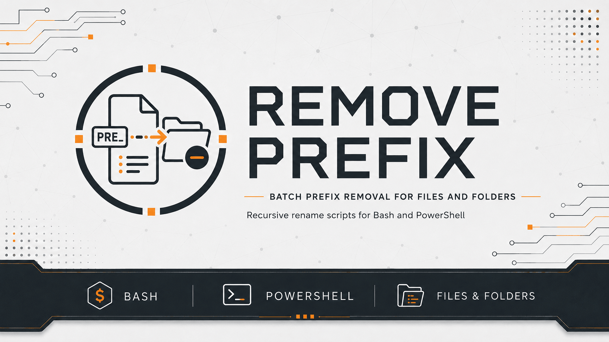
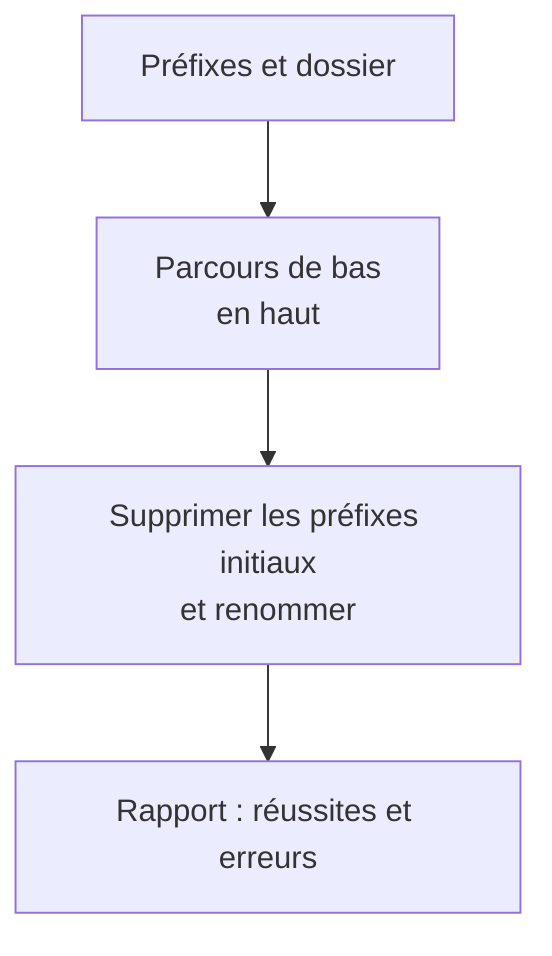

# Scripts pour supprimer les préfixes des noms de fichiers et dossiers

[](https://github.com/yaleksandr89/remove-prefix)
[](guides/usage.md)
[](guides/usage.md)
[](https://github.com/yaleksandr89/remove-prefix/actions/workflows/ci.yml)
[](../../../LICENSE.md)



[Русский](../../../README.md) | [English](../en/README.md) | [Español](../es/README.md) | [中文](../zh/README.md) | **Français** | [Deutsch](../de/README.md)

## Présentation

Remove Prefix supprime récursivement les préfixes initiaux indiqués des noms de fichiers et de dossiers dans un répertoire sélectionné. Il permet de nettoyer les noms après téléchargement, de simplifier les structures de projets et d’automatiser les renommages répétitifs.

- Plusieurs préfixes par exécution ; les préfixes initiaux répétés sont supprimés successivement.
- Bash pour Linux et macOS, PowerShell pour Windows.
- Rapport indiquant la durée, la mémoire utilisée et le nombre de fichiers et de dossiers renommés.

## Fonctionnement



## Démarrage rapide

Prérequis : Git pour cloner ; Windows 10/11 avec PowerShell 5.1 ou ultérieur, ou Linux/macOS avec Bash 4.0+ et `find`, `mv`, `ps`, `awk`, `date`, `bc`. Sur macOS, utilisez Bash 4.0+ depuis `PATH`, pas le `/bin/bash` 3.2 intégré.

**Les scripts modifient les noms sur le disque. Sauvegardez les données et testez d’abord sur une copie séparée. Ne les exécutez pas en tant qu’administrateur ou root sauf nécessité.**

### Windows (PowerShell)

```powershell
git clone https://github.com/yaleksandr89/remove-prefix.git
cd remove-prefix
.\scripts\remove_prefix.ps1
```

### Linux/macOS (Bash)

```bash
git clone https://github.com/yaleksandr89/remove-prefix.git
cd remove-prefix
bash scripts/remove_prefix.sh
```

Saisissez les préfixes séparés par des virgules, puis le chemin du dossier. Par exemple, `ad_,pre_` et le chemin d’un répertoire de test. Le dossier racine n’est pas renommé.

## Documentation

- [Utilisation et exemples](guides/usage.md)
- [Contribuer](CONTRIBUTING.md)
- [Sécurité](SECURITY.md)

## Retours et assistance

- [Signaler un problème ou proposer une amélioration](https://github.com/yaleksandr89/remove-prefix/issues)
- [Discussions et questions](https://github.com/yaleksandr89/remove-prefix/discussions)
- [Signaler une vulnérabilité](SECURITY.md)

<p align="center">Si ce projet vous a été utile, attribuez-lui une étoile sur GitHub pour aider les autres développeurs à le trouver. 🤘</p>
