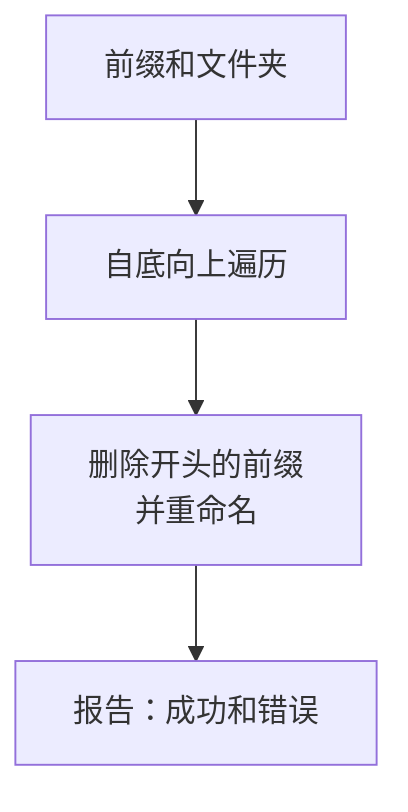

# 删除文件和文件夹名称前缀的脚本

[](https://github.com/yaleksandr89/remove-prefix)
[](guides/usage.md)
[](guides/usage.md)
[](https://github.com/yaleksandr89/remove-prefix/actions/workflows/ci.yml)
[](../../../LICENSE.md)


[Русский](../../../README.md) | [English](../en/README.md) | [Español](../es/README.md) | **中文** | [Français](../fr/README.md) | [Deutsch](../de/README.md)

## 概述

Remove Prefix 递归删除所选目录中文件和文件夹名称开头的指定前缀，可用于清理下载后的文件名、简化项目结构和自动化重复的重命名操作。

- 一次处理多个前缀，按顺序删除重复出现的开头前缀。
- Linux 和 macOS 使用 Bash，Windows 使用 PowerShell。
- 报告执行时间、内存使用情况和重命名的文件及文件夹数量。

## 工作原理



## 快速开始

要求：克隆需要 Git；Windows 10/11 使用 PowerShell 5.1 或更高版本；Linux/macOS 使用 Bash 4.0+ 以及 `find`、`mv`、`ps`、`awk`、`date`、`bc`。在 macOS 上使用 `PATH` 中的 Bash 4.0+，不要使用系统自带的 `/bin/bash` 3.2。

**脚本会更改磁盘上的名称。请先备份数据，并在独立副本上测试。除非必要，不要以管理员或 root 身份运行。**

### Windows (PowerShell)

```powershell
git clone https://github.com/yaleksandr89/remove-prefix.git
cd remove-prefix
.\scripts\remove_prefix.ps1
```

### Linux/macOS (Bash)

```bash
git clone https://github.com/yaleksandr89/remove-prefix.git
cd remove-prefix
bash scripts/remove_prefix.sh
```

输入以逗号分隔的前缀，再输入文件夹路径。例如 `ad_,pre_` 和测试目录的路径。根文件夹本身不会被重命名。

## 文档

- [使用方法和示例](guides/usage.md)
- [参与贡献](CONTRIBUTING.md)
- [安全](SECURITY.md)

## 反馈

- [报告问题或提出改进建议](https://github.com/yaleksandr89/remove-prefix/issues)
- [讨论与提问](https://github.com/yaleksandr89/remove-prefix/discussions)
- [报告安全漏洞](SECURITY.md)

<p align="center">如果这个项目对您有帮助，请在 GitHub 上点亮星标，让其他开发者更容易找到它。 🤘</p>
