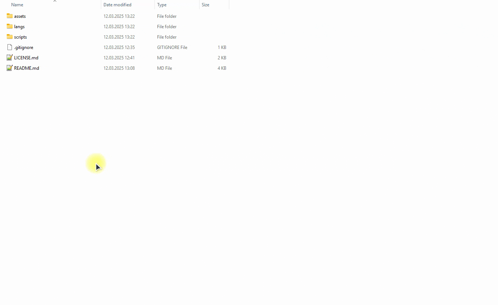
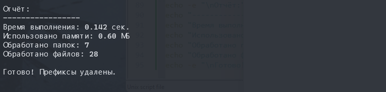

# 使用方法和示例

[删除文件和文件夹名称前缀的脚本](../README.md)

要求：克隆需要 Git；Windows 10/11 使用 PowerShell 5.1 或更高版本；Linux/macOS 使用 Bash 4.0+ 以及 `find`、`mv`、`ps`、`awk`、`date`、`bc`。在 macOS 上使用 `PATH` 中的 Bash 4.0+，不要使用系统自带的 `/bin/bash` 3.2。

**脚本会更改磁盘上的名称。请先备份数据，并在独立副本上测试。除非必要，不要以管理员或 root 身份运行。**

## Windows (PowerShell)

```powershell
git clone https://github.com/yaleksandr89/remove-prefix.git
cd remove-prefix
.\scripts\remove_prefix.ps1
```

如果执行策略阻止运行已检查的本地脚本，并且组织策略允许，可在当前会话使用 `Set-ExecutionPolicy -Scope Process -ExecutionPolicy RemoteSigned`。无需以管理员身份打开终端，也不要将用户策略设为 Unrestricted。

输入以逗号分隔的前缀，再输入文件夹路径。例如 `ad_,pre_` 和测试目录的路径。根文件夹本身不会被重命名。




## Linux/macOS (Bash)

```bash
git clone https://github.com/yaleksandr89/remove-prefix.git
cd remove-prefix
bash scripts/remove_prefix.sh
```

输入以逗号分隔的前缀，再输入文件夹路径。例如 `ad_,pre_` 和测试目录的路径。根文件夹本身不会被重命名。


## 处理顺序

按输入顺序处理前缀，区分大小写，只匹配名称开头。每个前缀在仍匹配时反复删除。例如，输入 `ad_,pre_` 时，`ad_ad_pre_photo.jpg` 变为 `photo.jpg`，而 `my_ad_photo.jpg` 保持不变。先处理嵌套项，再处理父文件夹。不要使用正在使用、共享或系统目录；应在没有并发重命名的稳定目录树上操作。不要依赖自动回滚或 Windows 隐藏项的处理（PowerShell 默认不枚举这些项）。

## 报告

报告显示耗时、内存使用量变化及成功重命名的文件和文件夹数量。请检查错误和冲突；报告不能代替结果验证。以下图片是较早的输出示例，并非保证值。




## 项目结构

`scripts/` 包含两个工具，`tests/` 包含回归检查，`docs/assets/` 包含封面和演示，`docs/langs/` 包含翻译。
